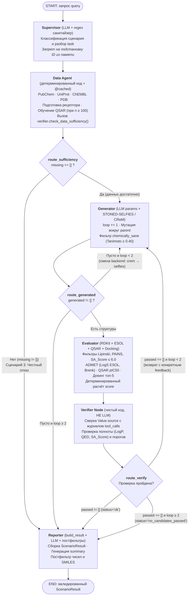
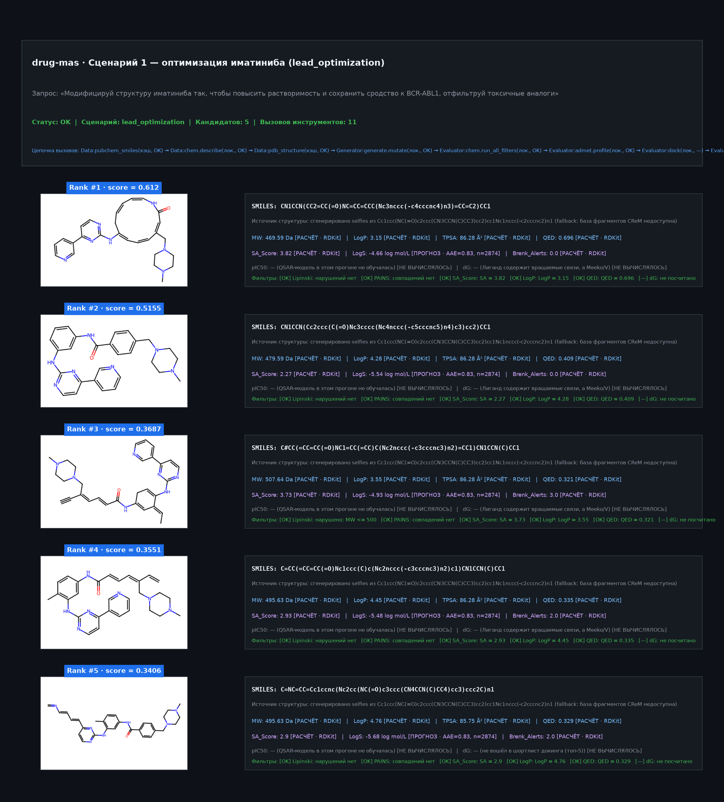
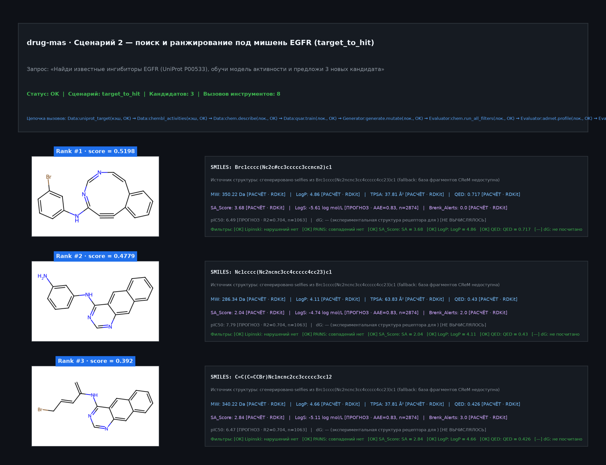
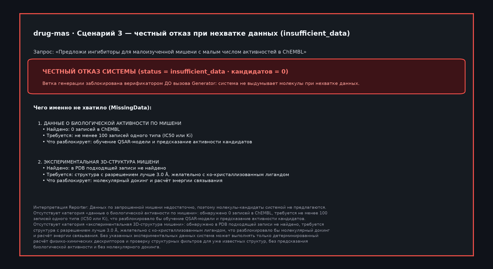

# `drug-mas` — мультиагентная система для *in silico* дизайна лекарственных молекул

**ХимБио-хакатон «Синтез» · ИТМО · 11–13 ноября 2026 · Кейс 1 (ПИШ ИТМО и Лаборатория химии ИИ)**

`drug-mas` — мультиагентная система на базе `LangGraph`, которая принимает исследовательский запрос на естественном языке, координирует опрос биомедицинских баз данных (`PubChem`, `ChEMBL`, `UniProt`, `RCSB PDB`), генерацию структурных аналогов (`STONED-SELFIES` / `CReM`), расчёт физико-химических и ADMET-свойств (`RDKit`, `Delaney ESOL`), обучение QSAR-моделей (`CatBoostRegressor` на фингерпринтах `ECFP4`) и молекулярный докинг (AutoDock Vina — при наличии в окружении, см. §7), возвращая строго валидированный результат (`ScenarioResult`), **в котором у каждого числапрограммно подтверждено происхождение**.

---

## Содержание

1. [Главная идея и защита от галлюцинаций](#1-главная-идея-и-защита-от-галлюцинаций)
2. [Быстрый старт и режимы работы](#2-быстрый-старт-и-режимы-работы)
3. [Архитектура мультиагентного графа](#3-архитектура-мультиагентного-графа)
4. [Эталонные сценарии и фактические результаты](#4-эталонные-сценарии-и-фактические-результаты)
5. [Структура репозитория и документация](#5-структура-репозитория-и-документация)
6. [Автотесты и верификация инвариантов](#6-автотесты-и-верификация-инвариантов)
7. [Инженерные ограничения прототипа](#7-инженерные-ограничения-прототипа)

---

## 1. Главная идея и защита от галлюцинаций

Главный архитектурный принцип проекта — **«LLM — для интерфейса, детерминированный код — для чисел»**.
В отличие от систем, где языковая модель проверяет сама себя через промпт-критика, в `drug-mas` валидация данных, порогов медицинской химии и подлинности источников зашита в контракты `Pydantic v2` ([`src/schemas.py`](src/schemas.py)) и кодовый узел верификатора ([`src/verifier.py`](src/verifier.py)).

### Четыре категории происхождения данных (`Provenance`)

Каждое свойство молекулы в системе упаковывается в типизированный объект `Value` с обязательной категорией `Provenance`:

| Бейдж в UI | Категория `Provenance` | Описание и примеры источников (`Value.source`) | Инвариант валидатора |
| :--- | :--- | :--- | :--- |
| 🗄 **БД** | `DATABASE` | Экспериментальная запись из внешней базы данных с точным ID (`PubChem CID 5291`, `CHEMBL63786`, `UniProt P00533`, `PDB 1IEP`) | Поле `source` обязательно ($\ge 3$ символов) и сверяется с логом вызовов БД |
| 🧮 **РАСЧЁТ** | `COMPUTED` | Детерминированный расчёт по 2D/3D-структуре (`RDKit 2026.09.2 Descriptors.MolWt`, `Crippen.MolLogP`, `QED`, `SA_Score`, `FilterCatalog.BRENK`, `AutoDock Vina`) | Выполняется локально без обращения к LLM |
| 📈 **ПРОГНОЗ** | `PREDICTED` | Предсказание эмпирической или ML-модели (`CatBoostRegressor (ECFP4 2048)`, `ESOL (Delaney 2004)`) | **Обязательно** заполнено поле `model_metrics` (`R2`/`ROC-AUC`/`AAE`, `n_train`, `split`) |
| 💭 **ГИПОТЕЗА** | `HYPOTHESIS` | Текстовое предположение или интерпретация, не подкреплённая расчётом | Числовое поле `value` **обязано** быть `None` (числа и строки-числа блокируются) |
| ⬜ **НЕ ВЫЧИСЛЯЛОСЬ** | `not_computed(...)` | Явно зафиксированный пропуск расчёта с указанием причины в `note` (например, `dG` без установленных `Meeko`/`Vina`) | `value=None`; не считается провалом порога и не обнуляет рейтинг |

### Четыре уровня программной защиты

1. **Контракт типов (`src/schemas.py`)**:
   - Невозможно создать объект `Value` без `provenance` и `source`.
   - Любое предсказание (`Provenance.PREDICTED`) без паспорта модели (`ModelMetrics`) выбрасывает `ValidationError`.
   - Гипотеза (`Provenance.HYPOTHESIS`) физически не может содержать число (включая число, записанное строкой `"-9.1"`).
2. **Сверка с независимым журналом вызовов (`src/verifier.py`)**:
   - Схема гарантирует наличие строки `source`, но её подлинность проверяет функция `check_provenance(candidates, tool_calls)` по словарю `SOURCE_REQUIRES_TOOL`.
   - Если у значения в `source` указано `"AutoDock Vina..."`, `"CatBoost..."`, `"CHEMBL..."` или `"PubChem..."`, но в журнале `state["tool_calls"]` текущего прогона нет успешного вызова (`ok=True`) соответствующего инструмента (`dock`, `qsar.predict`, `chembl_activities`, `pubchem_smiles`), **кандидат дисквалифицируется целиком** (попадает в `unverifiable`), а не проходит со сноской.
3. **Детерминированный гейт достаточности данных до генерации (`check_data_sufficiency`)**:
   - При поиске под мишень код проверяет два условия: объём выборки активностей в ChEMBL ($n_{\text{activities}} \ge 100$ для обучения QSAR) и наличие экспериментальной 3D-структуры рецептора в PDB (разрешение $\le 3.0\text{ \AA}$).
   - Если данные отсутствуют (`missing != []`), условный роутер `route_sufficiency` **блокирует запуск `Generator` и `Evaluator`** (`0` сгенерированных молекул) и переводит систему в статус честного отказа (`status="insufficient_data"`).
4. **Изоляция LLM и кодовые постфильтры (`src/agents/reporter.py`)**:
   - Ни один агент не генерирует SMILES и не вычисляет свойства молекул.
   - Узел `Reporter` получает на вход **только сериализованный и уже заблокированный объект `ScenarioResult`**. Сгенерированный им текст проверяется двумя кодовыми постфильтрами: `_extraneous_numbers` (блокирует любые числа, отсутствующие в полях `ScenarioResult`) и `_postfilter_insufficient_data_smiles` (принудительно вырезает любые валидные SMILES из текста при отказе по недостатку данных).

---

## 2. Быстрый старт и режимы работы

Требуется **Python 3.10+** (проверено на Python 3.11–3.14). Системные бинарники для запуска демо и тестов не требуются.

### Развёртывание в 5 команд

```bash
python -m venv .venv && source .venv/bin/activate   # Windows: .venv\Scripts\activate
pip install -r requirements.txt
cp .env.example .env                                # по умолчанию OFFLINE=1 (ключ LLM не нужен)
OFFLINE=1 python -m pytest -q                       # 46 passed
OFFLINE=1 streamlit run app.py
```

### Режимы работы

1. **Автономный режим (`OFFLINE=1`, рекомендуется для демонстрации и проверки):**
   Все ответы внешних баз (`PubChem CID 5291`, `PDB 1IEP`, `UniProt P00533`, `ChEMBL CHEMBL203` — 2000 записей $\text{IC}_{50}$) и закэшированные ответы LLM сохранены в директории [`cache/`](cache/). При этом вся хемоинформатика — мутации `STONED-SELFIES`, расчёт дескрипторов и 3D-конформеров `RDKit`, фильтры `Lipinski`/`PAINS`/`Brenk`, оценка `SA Score`, обучение и инференс `CatBoost QSAR`, расчёт растворимости `ESOL` и работа `verifier.py` — выполняется в реальном времени на CPU.
2. **Онлайн-режим с живой LLM и внешними API (`OFFLINE=0`):**
   Укажите `OFFLINE=0`, `LLM_API_KEY`, `LLM_MODEL` и (при необходимости) `LLM_BASE_URL` в файле `.env`. Все новые ответы баз данных и LLM автоматически сохраняются в `cache/` через декоратор `@cached`.
3. **Проверка состояния локального кэша:**
   ```bash
   python -m src.cache
   ```

### Программный запуск и воспроизведение эталонных JSON-выгрузок

Готовые сериализованные результаты всех трёх сценариев и скриншоты интерфейса находятся в папке [`examples/`](examples/). Чтобы пересобрать `examples/scenario{1,2,3}.json` напрямую из кода графа:

```bash
OFFLINE=1 python -c '
from pathlib import Path
from src.graph import run_graph

queries = {
    "scenario1": "Модифицируй структуру иматиниба так, чтобы повысить растворимость и сохранить сродство к BCR-ABL1, отфильтруй токсичные аналоги",
    "scenario2": "Найди известные ингибиторы EGFR (UniProt P00533), обучи модель активности и предложи 3 новых кандидата",
    "scenario3": "Предложи ингибиторы для малоизученной мишени с малым числом активностей в ChEMBL",
}
for name, q in queries.items():
    res = run_graph(q)
    Path(f"examples/{name}.json").write_text(res.model_dump_json(indent=2), encoding="utf-8")
'
```

---

## 3. Архитектура мультиагентного графа

Система построена как типизированный граф состояний `StateGraph(GraphState)` на `LangGraph` ([`src/graph.py`](src/graph.py), [`src/graph_state.py`](src/graph_state.py)), где поле `tool_calls` работает как только-добавляемый журнал (`Annotated[list[ToolCall], operator.add]`), а число итераций генерации строго ограничено константой `MAX_LOOPS = 2`.



### Пошаговая работа узлов

1. **`supervisor` ([`src/agents/supervisor.py`](src/agents/supervisor.py))**:
   Классифицирует запрос (`lead_optimization` | `target_to_hit` | `insufficient_data_demo`) и извлекает структуру `task`. Кодовый санитайзер `_sanitize_task_against_query` принудительно обнуляет любые идентификаторы (`SMILES`, `UniProt`, `ChEMBL`, `PDB`), если они не присутствовали в тексте запроса дословно, а фильтр `_looks_like_target` отсекает общие русские слова и предлоги.
2. **`data_agent` ([`src/agents/data_agent.py`](src/agents/data_agent.py)) и роутер `route_sufficiency`**:
   Через кэш `@cached` опрашивает `pubchem_smiles`, `uniprot_target`, `chembl_activities` и `pdb_structure`. При $n_{\text{activities}} \ge 100$ обучает регрессионную QSAR-модель (`qsar.train_from_chembl`). В конце узла вызывает `verifier.check_data_sufficiency(n_activities, has_structure)`: если данных недостаточно, роутер `route_sufficiency` сразу направляет граф в `reporter`, минуя генерацию.
3. **`generator` ([`src/agents/generator.py`](src/agents/generator.py)) и роутер `route_generated`**:
   Инкрементирует счётчик `loop += 1` и вызывает `tools.generate.mutate` вокруг исходной молекулы `parent` с учётом `feedback` верификатора. Каждая структура проходит детерминированный фильтр `chemically_sane` (отсев радикалов, ненулевого формального заряда, кумуленов `C=C=C`, нелекарственных атомов и структур с близостью Танимото $< 0.40$ к родителю) и дедупликацию против `rejected_all`.
4. **`evaluator` ([`src/agents/evaluator.py`](src/agents/evaluator.py))**:
   Выполняет конвейер расчётов:
   - `chem.run_all_filters`: дескрипторы RDKit (`MW`, `LogP`, `TPSA`, `HBD`, `HBA`, `RotB`, `HeavyAtoms`, `Rings`, `QED`, `SA_Score`) и фильтры `Lipinski` ($\le 1$ нарушения), `PAINS` ($0$ совпадений), `SA_Score` ($\le 6.0$);
   - `admet.profile`: растворимость `LogS` по уравнению Delaney ESOL (`PREDICTED`, `AAE = 0.83`, $n_{\text{train}} = 2874$) и структурные токсикофоры `Brenk_Alerts` (`COMPUTED`);
   - `qsar.predict`: предсказание `pIC50` (`PREDICTED`) с прикреплением `ModelMetrics`;
   - `docking.dock`: для шортлиста топ-5 кандидатов при наличии 3D-рецептора;
   - `compute_score`: детерминированный расчёт интегрального рейтинга `score` $\in [0, 1]$ с пропорциональной перенормировкой весов для свойств со статусом `not_computed`.
5. **`verifier_node` ([`src/verifier.py`](src/verifier.py)) и роутер `route_verify`**:
   Проверяет подлинность источников по журналу `tool_calls`, полноту обязательных полей ранжирования (`REQUIRED_FOR_RANKING = ("LogP", "QED", "SA_Score")`) и пороги `Thresholds` ($\text{LogP} \le 5.0$, $\text{QED} \ge 0.30$, $\text{SA Score} \le 6.0$, $\Delta G \le -6.0\text{ ккал/моль}$). При отсеве всех кандидатов на 1-м круге формирует конкретный `feedback` для 2-го круга генерации.
6. **`reporter` ([`src/agents/reporter.py`](src/agents/reporter.py))**:
   Собирает финальный `ScenarioResult` через `verifier.build_result`, передаёт сериализованный JSON в LLM для написания резюме на русском языке с пометками `(БД)`, `(расчёт)`, `(прогноз)` и проверяет текст кодовыми постфильтрами чисел и SMILES.

---

## 4. Эталонные сценарии и фактические результаты

Подробный пошаговый разбор каждого сценария приведён в [`docs/scenarios.md`](docs/scenarios.md). Эталонные JSON-выгрузки и скриншоты карточек находятся в папке [`examples/`](examples/).

| Параметр | Сценарий 1 (`lead_optimization`) | Сценарий 2 (`target_to_hit`) | Сценарий 3 (`insufficient_data`) |
| :--- | :--- | :--- | :--- |
| **Запрос** | «Модифицируй структуру иматиниба так, чтобы повысить растворимость и сохранить сродство к BCR-ABL1, отфильтруй токсичные аналоги» | «Найди известные ингибиторы EGFR (UniProt P00533), обучи модель активности и предложи 3 новых кандидата» | «Предложи ингибиторы для малоизученной мишени с малым числом активностей в ChEMBL» |
| **Данные из БД (`🗄 БД`)** | `PubChem CID 5291` (иматиниб: `LogP = 4.59`, `LogS = -6.09`), `PDB 1IEP` (`2.1 Å`, центр бокса `(15.614, 53.38, 15.455)` по `STI`) | `UniProt P00533` $\to$ `CHEMBL203` ($2000$ записей $\text{IC}_{50}$), референсный хит `CHEMBL63786` ($\text{IC}_{50} = 0.003\text{ nM}$) | `n_activities = 0` в ChEMBL, `has_structure = False` в PDB |
| **Расчёты и модели** | STONED-SELFIES (7 аналогов) $\to$ RDKit + ESOL (`AAE = 0.83`, $n = 2874$) + Brenk $\to$ 5 кандидатов прошли пороги | `CatBoostRegressor (ECFP4 2048)` ($n_{\text{train}} = 1063$, `random 80/20`, $R^2 = 0.704$) + RDKit + ESOL $\to$ 3 кандидата | Роутер `route_sufficiency` заблокировал `Generator` и `Evaluator` (`0` вызовов) |
| **Статус и лидеры** | `status="ok"`, 5 кандидатов.<br/>**Rank #1 (`score = 0.612`)**: `LogP = 3.15` (снижен с `4.59`), `LogS = -4.66 log mol/L` (рост растворимости в ~27 раз), `QED = 0.696`, `SA_Score = 3.82`, `Brenk = 0` | `status="ok"`, 3 кандидата.<br/>**Rank #1 (`score = 0.5198`)**: `pIC50 = 6.49` ($R^2 = 0.704$), `QED = 0.717`, `SA_Score = 3.68`.<br/>**Rank #2 (`score = 0.4779`)**: `pIC50 = 7.79`, `SA_Score = 2.04` | **`status="insufficient_data"`**, **`candidates = []` (0 молекул)**.<br/>2 карточки `MissingData` (нужно $\ge 100$ записей $\text{IC}_{50}$ и структура PDB $\le 3.0\text{ \AA}$) |
| **Артефакты в `examples/`** | [`scenario1.json`](examples/scenario1.json) · [`scenario1.png`](examples/scenario1.png) | [`scenario2.json`](examples/scenario2.json) · [`scenario2.png`](examples/scenario2.png) | [`scenario3.json`](examples/scenario3.json) · [`scenario3.png`](examples/scenario3.png) |

### Визуализация эталонных карточек (`examples/scenario{1,2,3}.png`)

* **Сценарий 1 — Оптимизация иматиниба (`lead_optimization`):**
  

* **Сценарий 2 — Поиск кандидатов под мишень EGFR (`target_to_hit`):**
  

* **Сценарий 3 — Честный отказ при недостатке данных (`insufficient_data`):**
  

---

## 5. Структура репозитория и документация

```text
drug-mas/
├── app.py                        # Веб-интерфейс Streamlit: пресеты сценариев, журнал ToolCall, карточки с бейджами
├── requirements.txt              # Зависимости проекта (RDKit, Pydantic v2, LangGraph, CatBoost, scikit-learn, Streamlit)
├── .env.example                  # Шаблон конфигурации окружения (OFFLINE, CACHE_DIR, LLM_API_KEY, LLM_MODEL)
├── src/
│   ├── schemas.py                # Контракт данных Pydantic v2: Provenance, ModelMetrics, Value, Candidate, ScenarioResult
│   ├── verifier.py               # Детерминированный верификатор источников, полноты, порогов и достаточности данных
│   ├── cache.py                  # Файловый кэш @cached внешних вызовов и поддержка автономного режима OFFLINE=1
│   ├── graph_state.py            # Определение состояния GraphState и кэшируемый клиент OpenAI-совместимого API
│   ├── graph.py                  # Сборка и компиляция мультиагентного графа LangGraph (MAX_LOOPS = 2)
│   ├── agents/
│   │   ├── supervisor.py         # Классификация сценария, разбор запроса в task и защита от галлюцинации ID
│   │   ├── data_agent.py         # Каскадный опрос PubChem/UniProt/ChEMBL/PDB, подготовка рецептора и обучение QSAR
│   │   ├── generator.py          # Управление мутациями вокруг parent с учётом feedback и дедупликацией
│   │   ├── evaluator.py          # Запуск фильтров RDKit, ADMET, QSAR, докинга и расчёт интегрального score
│   │   └── reporter.py           # Сборка ScenarioResult, генерация текстового резюме и кодовые постфильтры
│   └── tools/
│       ├── chem.py               # RDKit: дескрипторы, SA Score, Lipinski, PAINS, 3D-конформеры ETKDGv3/MMFF94, ECFP4
│       ├── databases.py          # Кэшируемые клиенты PubChem PUG-REST, UniProt REST, ChEMBL и RCSB PDB
│       ├── generate.py           # Генерация структур (STONED-SELFIES / CReM) и фильтр chemically_sane
│       ├── qsar.py               # Обучение и инференс CatBoostRegressor / RandomForestRegressor на ECFP4 (2048 бит)
│       ├── admet.py              # Растворимость Delaney ESOL (PREDICTED), токсикофоры Brenk и классификаторы ADMET
│       └── docking.py            # Извлечение центра кармана по лиганду, подготовка PDBQT, AutoDock Vina и контакты
├── cache/                        # Прогретый локальный кэш ответов PubChem, UniProt, ChEMBL, PDB и LLM
├── examples/                     # Эталонные выгрузки scenario{1,2,3}.json и визуальные карточки scenario{1,2,3}.png
├── docs/
│   ├── architecture.md           # Подробное описание архитектуры, узлов графа, верификации и формулы compute_score
│   ├── scenarios.md              # Полная сводка и пошаговый разбор результатов трёх демонстрационных сценариев
│   ├── GRAPH-CONTRACT.md         # Формальная спецификация GraphState, инвариантов tool_calls и системных промптов
│   └── inf.pdf                   # Справочная публикация (Ramos & White, Digital Discovery, 2024) по калибровке моделей
└── tests/
    ├── test_tools.py             # 29 модульных тестов: схемы, RDKit-фильтры, верификатор, докинг, QSAR, ADMET, генератор
    └── test_graph.py             # 17 интеграционных тестов: сценарии 1–3, защита от циклов, роутеры и постфильтры
```

---

## 6. Автотесты и верификация инвариантов

Тестовый набор включает **46 автотестов** и выполняется полностью автономно (`OFFLINE=1`):

```bash
OFFLINE=1 python -m pytest -v
```

Что проверяется тестами:
* **`tests/test_tools.py` (29 тестов)**:
  - отклонение объектов `Value` без источника, `PREDICTED` без `ModelMetrics`, `HYPOTHESIS` с числом или числом-строкой (`"-9.1"`);
  - дисквалификация кандидата при подписи `source="AutoDock Vina..."` без успешного вызова `ToolCall(tool="dock", ok=True)` в текущем прогоне (`test_signed_without_call_is_disqualified`);
  - блокировка ранжирования при отсутствии обязательных дескрипторов (`LogP`, `QED`, `SA_Score`) или при обучении QSAR на слишком малой выборке ($n_{\text{train}} < 100$);
  - расчёт дескрипторов и фильтров RDKit, генерация 3D-конформеров, извлечение центра кармана связывания из PDB, запрет жёсткого докинга (`TORSDOF 0`) гибких молекул без `Meeko`, обучение `CatBoost`/`RandomForest` QSAR и расчёт растворимости `ESOL`.
* **`tests/test_graph.py` (17 тестов)**:
  - сквозное прохождение Сценариев 1, 2 и 3 из локального кэша;
  - гарантированная остановка графа ровно за `MAX_LOOPS = 2` круга при заведомо невыполнимых порогах (`Thresholds(max_logp=-99)`);
  - дословное совпадение системных промптов всех 5 агентов со спецификацией `docs/GRAPH-CONTRACT.md`;
  - переключение бэкенда генератора (`crem` $\to$ `selfies`) при пустой выдаче и сохранение накопленных `unverifiable_all` и `rejected_all` между итерациями;
  - работа кодовых постфильтров `Reporter` (удаление случайно сгенерированных SMILES на ветке `insufficient_data` и перехват чисел, отсутствующих в `ScenarioResult`).

---

## 7. Инженерные ограничения прототипа

1. **Локальная генерация структур (`src/tools/generate.py`)**:
   Для быстрой работы на CPU без гигабайтных баз фрагментов используется алгоритм точечных мутаций **STONED-SELFIES** (Nigam et al., *Chem. Sci.*, 2021) поверх детерминированного фильтра медицинской химии `chemically_sane` с порогом близости Танимото $\ge 0.40$ (ECFP4) к родительской молекуле. Каждая структура проходит санитизацию RDKit и фильтр chemically_sane, поэтому невалидных валентностей в выдаче нет; близость к родителю ограничена порогом Танимото, но сохранение фармакофора этим порогом не доказывается.
2. **Оценка водной растворимости ESOL (`src/tools/admet.py`, калибровка по [`docs/inf.pdf`](docs/inf.pdf))**:
   Логарифм молярной растворимости $\log S$ вычисляется по линейной регрессии **Delaney 2004 (ESOL)**. В соответствии с выводами *Ramos & White (Digital Discovery, 2024)* любая расчётная оценка растворимости имеет существенную эмпирическую погрешность, поэтому `LogS` в системе строго маркируется как `Provenance.PREDICTED` и сопровождается паспортными метриками модели (`AAE = 0.83 log S`, `n_train = 2874`), а не выдаётся за точный физический расчёт.
3. **Классификаторы токсичности и метаболизма ADMET (`src/tools/admet.py`)**:
   Детерминированные физико-химические дескрипторы (`MW`, `LogP`, `TPSA`, `HBD`, `HBA`, `RotB`) и структурные предупреждения `Brenk_Alerts` вычисляются через RDKit (`Provenance.COMPUTED`). Для ML-эндпоинтов `hERG`, `Ames` и `CYP3A4` при отсутствии загруженных весов бинарных классификаторов система не подменяет их эвристиками, а возвращает честный статус `not_computed` (`⬜ НЕ ВЫЧИСЛЯЛОСЬ`).
4. **Молекулярный докинг и гибкость лигандов (`src/tools/docking.py`)**:
   Система автоматически скачивает кристаллическую структуру рецептора из PDB (`1IEP`), очищает её от молекул воды и буферных ионов, находит геометрический центр кармана по ко-кристаллизованному лиганду (`STI`) и строит 3D-конформер кандидата (`ETKDGv3` + `MMFF94`). Если в окружении отсутствуют `Meeko` (построение дерева торсий `BRANCH`/`TORSDOF`) и бинарник `AutoDock Vina`, система **блокирует физически некорректный жёсткий докинг (`TORSDOF 0`)** гибких молекул и явно помечает `dG` как `не посчитано`, исключая $\Delta G$ из формулы ранжирования.
5. **Валидация QSAR-модели (`src/tools/qsar.py`)**:
   Модель `CatBoostRegressor (ECFP4 2048)` (с автоматическим фолбэком на `RandomForestRegressor`) обучается на 1063 уникальных структурах ингибиторов EGFR (`CHEMBL203`) со случайным разбиением `random 80/20` ($R^2 = 0.704$). Поскольку на гомологических сериях ChEMBL `random split` даёт более оптимистичную оценку, чем строгий `scaffold split` по Bemis–Murcko, тип разбиения (`split = "random 80/20"`) явно выводится в паспорте каждого предсказания.
6. **Синтетическая доступность (`SA Score`)**:
   Показатель `SA Score` (Ertl & Schuffenhauer, 2009, шкала 1–10, порог верификатора $\le 6.0$) является статистической эвристикой по частоте встречаемости фрагментов в PubChem и стереохимической сложности и служит для отсева несинтезируемых структур, но не заменяет построение полного маршрута ретросинтеза.
