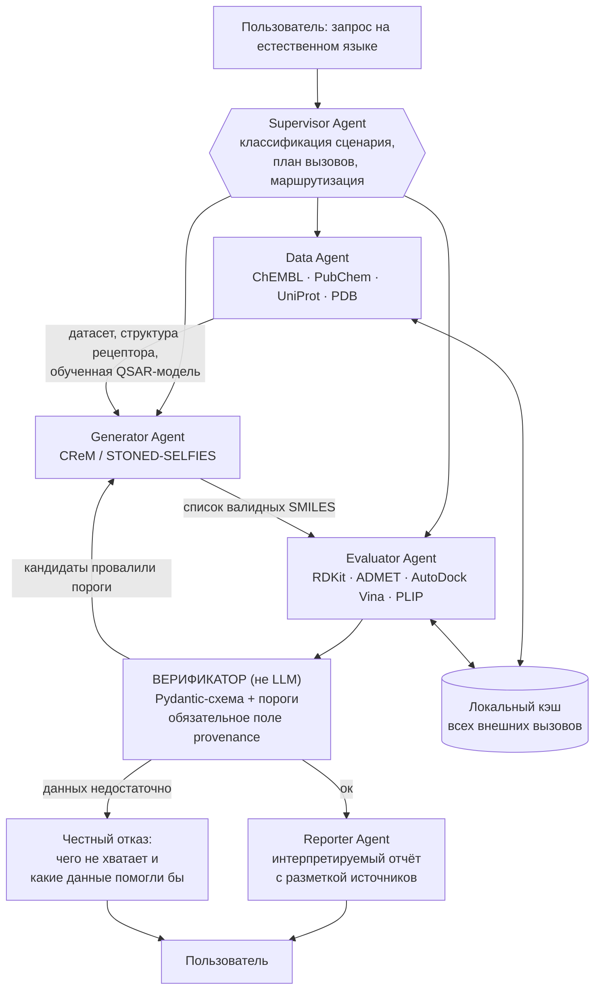

# КЕЙС 1 «МАС ДЛЯ ДИЗАЙНА ЛЕКАРСТВЕННЫХ МОЛЕКУЛ» — РАБОЧИЙ ПЛАН
**ХимБио-хакатон «Синтез», ИТМО, 11–13 ноября 2026. Заказчик: ПИШ ИТМО / Лаборатория химии ИИ.**
Файл составлен 11.11.2026, 19:00 МСК. Единственный источник правды по плану — этот файл.

---

## 0. ДОПУЩЕНИЯ, КОТОРЫЕ НАДО ПОДТВЕРДИТЬ ИЛИ ИСПРАВИТЬ

Плана без этих чисел не бывает, а их нам не сообщили. Приняты следующие допущения — если что-то не так, план по часам сдвигается, и это надо сказать сразу, а не в четверг вечером.

| # | Допущение | Если неверно |
|---|---|---|
| A1 | Защита — 13.11 во второй половине дня. Код замораживаем 13.11 в 12:00 | Сдвинуть всю сетку, сохранив пропорции: 45% времени — Tools Layer, 25% — граф агентов, 20% — демо и упаковка, 10% — репетиция |
| A2 | В команде 3–4 человека, минимум двое уверенно пишут на Python | При двух людях вырезать Сценарий 2 (QSAR) целиком, оставить 2 сценария + сценарий отказа |
| A3 | Никто в команде раньше не запускал AutoDock Vina руками | Если кто-то запускал — он берёт блок D1 и экономит команде ~4 часа |
| A4 | Своего GPU нет, считаем всё на CPU | С GPU можно вернуть ESMFold, но всё равно не нужно — см. §2 |
| A5 | Интернет на защите может отвалиться | Кэш обязателен независимо от ответа |

---

## 1. ЧТО ОЦЕНИВАЮТ (из ТЗ и брифинга)

Четыре критерия: **архитектура и роли агентов**, **работоспособность прототипа**, **обоснованность предложенных молекул**, **применимость в реальной разработке препаратов**.

Пять требований к прототипу, каждое надо уметь показать пальцем в код:
1. Несколько взаимодействующих агентов, LLM — ключевой компонент управления.
2. Запросы на естественном языке и координация агентов.
3. Интеграция внешних научных инструментов, моделей или баз.
4. Интерпретируемые ответы, выполнение заявленных сценариев.
5. **Прозрачное различение реальных расчётов, предсказаний и гипотез; отсутствие вымышленных результатов.**

На защиту: схема архитектуры · работающий прототип на ≥3 сценариях · описание сценариев (запрос → ожидаемый ответ → действия → фактический результат) · репозиторий с инструкцией запуска · краткая презентация с ограничениями.

**Ставка команды — пункт 5.** Мультиагентную обёртку над RDKit принесут почти все. Систему, которая отказывается отвечать при недостатке данных и маркирует каждое число источником, — почти никто. Это единственное, на чём мы можем выиграть за 40 часов.

---

## 2. SCOPE: ЧТО ДЕЛАЕМ И ЧТО НЕ ДЕЛАЕМ

### Делаем
Направление **А (малые молекулы)** целиком + **минимальный срез направления Б**: берём готовую экспериментальную структуру из PDB по ID, у которой есть ко-кристаллизованный лиганд, и используем его координаты как бокс для докинга. Это 20–30 строк кода.

### Не делаем — и это осознанное решение
| Вырезано | Почему |
|---|---|
| ESMFold / AlphaFold-фолдинг по сиквенсу | Отдельный стек, отдельная точка отказа, нулевой вклад в критерии оценки |
| P2Rank / fpocket (поиск кармана с нуля) | Заменяется координатами ко-кристаллизованного лиганда |
| ProteinMPNN, дизайн белковых последовательностей | Не относится к дизайну лекарственных молекул в нашем сценарии |
| REINVENT 4, MolGPT, DiffDock, GNINA | Тяжёлые модели, часы на установку и веса; CReM/STONED дают валидные структуры без GPU |
| Обучение собственной ADMET-модели | Берём готовую |

Если на вопрос жюри «почему не сделали белковую часть» — ответ есть в §9.

---

## 3. АРХИТЕКТУРА

**Тип: иерархический граф (LangGraph) с циклом возврата.** Четыре LLM-агента + детерминированный слой верификации.



### Роли

| Агент | Вход | Что делает | Выход |
|---|---|---|---|
| **Supervisor** | Запрос NL | Классифицирует сценарий (lead optimization / target-to-hit / анализ связывания), строит план вызовов, маршрутизирует, решает когда остановить цикл | План + маршрут |
| **Data Agent** | Название мишени, UniProt/PDB ID, название молекулы | Тянет SMILES из PubChem, известные ингибиторы и IC50 из ChEMBL, структуру из PDB, координаты бокса из ко-кристаллизованного лиганда; при достаточной выборке обучает QSAR на ECFP4 | Датасет, рецептор, модель |
| **Generator** | Исходный хит + ограничения (или скаффолд) | Мутации скелета и замена R-групп через CReM; фолбэк — STONED-SELFIES | Список валидных SMILES |
| **Evaluator** | SMILES-кандидаты + рецептор | RDKit (MW, LogP, TPSA, QED, SA Score, Lipinski, PAINS) → ADMET → докинг Vina → PLIP → многопараметрическое ранжирование | Таблица с числами и их происхождением |
| **Reporter** | Верифицированный результат | Собирает отчёт на естественном языке, обязан ссылаться только на поля из структуры | Ответ пользователю |

### Почему именно так (вопрос жюри №1)
Не «потому что мультиагентность в ТЗ». Конкретно: задачи требуют **разных** инструментов с несовместимыми форматами данных (SMILES, FASTA, PDBQT) и **цикла** — если кандидат провалил фильтр токсичности, надо вернуться к генерации с конкретным фидбеком («снизить LogP ниже 4»), а не начинать заново. Один агент с плоским набором функций этот цикл не держит: он теряет контекст того, что уже было отвергнуто и почему. Граф состояний LangGraph даёт явный цикл возврата и явные точки отказа.

### Критик — не агент, а схема
**Это ключевое отличие от того, что сделают остальные.** Если проверку «не выдумал ли LLM число» поручить LLM-агенту, она держится на промпте и рано или поздно развалится на защите. Поэтому:

```python
from enum import Enum
from pydantic import BaseModel, Field

class Provenance(str, Enum):
    DATABASE   = "database"    # пришло из ChEMBL/PubChem/PDB, с ID записи
    COMPUTED   = "computed"    # посчитано детерминированно: RDKit, Vina
    PREDICTED  = "predicted"   # прогноз ML-модели, с метрикой качества модели
    HYPOTHESIS = "hypothesis"  # рассуждение LLM, числами не подкреплено

class Value(BaseModel):
    name: str
    value: float | str
    units: str | None = None
    provenance: Provenance              # обязательное, без default
    source: str = Field(min_length=3)   # CHEMBL ID / "RDKit 2025.03 Descriptors.MolLogP" / "AutoDock Vina 1.2.5" / имя модели + R²
```

Агент физически не может вернуть число без указания происхождения — Pydantic не даст. На фронте каждое значение рисуется с бейджем своего цвета. В отчёт Reporter попадают только поля из валидированной структуры; свободный текст LLM идёт отдельным блоком с пометкой «интерпретация».

---

## 4. СТЕК

| Слой | Выбор | Примечание |
|---|---|---|
| Оркестрация | **LangGraph** | Жёсткий граф состояний, циклы, параллельные ветки |
| Контракты данных | **Pydantic v2** | См. §3, несущая конструкция требования №5 |
| Химия | **RDKit** | ETKDG + MMFF94 для 3D, Morgan/ECFP4, QED, FilterCatalog для PAINS, sascorer из Contrib для SA Score |
| Генерация | **CReM** → фолбэк **STONED-SELFIES** | ⚠️ CReM требует скачать базу фрагментов (replacements). Качать **в первый час**, брать самую маленькую. Если не завелось за 60 минут — STONED-SELFIES, ему БД не нужна, только `pip install selfies` |
| Данные | `chembl_webresource_client`, PUG-REST (PubChem), RCSB API, UniProt REST | Всё через обёртку с кэшем на диск |
| ADMET | **ADMET-AI** → фолбэк RDKit-фильтры + своя CatBoost на датасете hERG из TDC | ⚠️ Тянет torch + chemprop. Таймбокс на установку — 45 минут, дальше фолбэк |
| QSAR | scikit-learn / CatBoost на ECFP4 | Обучение на выгрузке ChEMBL по мишени |
| Докинг | **AutoDock Vina** (`pip install vina`) + **Meeko** + OpenBabel для PDBQT | ⚠️ Главный риск проекта, см. D1 |
| Взаимодействия | **PLIP** | Таблица водородных связей и гидрофобных контактов для обоснования выбора молекулы |
| Фронт | **Streamlit** + **stmol/py3Dmol** | Чат, лог вызовов инструментов, таблица рейтинга, 2D-структуры, 3D-комплекс |
| LLM | То, к чему есть стабильный доступ | Промпты писать модель-агностично, менять одной переменной |

### Офлайн-режим — обязателен
Все внешние вызовы идут через один декоратор `@cached(ttl=None)`, пишущий JSON в `./cache/`. К 22:00 12 ноября кэш должен содержать **полные прогоны всех трёх сценариев**. Флаг `OFFLINE=1` в `.env` заставляет систему брать только из кэша. На защите запускаемся с `OFFLINE=1` по умолчанию; живой вызов делаем один раз и только если сеть есть.

---

## 5. ТРИ СЦЕНАРИЯ

### Сценарий 1 — Оптимизация существующего соединения (главный, его показываем первым)
> «Модифицируй структуру иматиниба так, чтобы повысить растворимость и сохранить сродство к BCR-ABL1, отфильтруй токсичные аналоги»

Действия: PubChem → SMILES иматиниба; PDB → структура BCR-ABL1 (брать запись с ко-кристаллизованным иматинибом, координаты бокса оттуда); CReM → 50 аналогов; RDKit → Lipinski, QED, SA Score, PAINS; ADMET → hERG, растворимость; Vina → докинг топ-5; PLIP → контакты.

Ответ: таблица топ-5 с LogP/LogS, ΔG в ккал/моль, 3D-поза в кармане, у каждого числа — бейдж происхождения.

### Сценарий 2 — Поиск и ранжирование под мишень
> «Найди известные ингибиторы EGFR (UniProt P00533), обучи модель активности и предложи 3 новых кандидата»

Действия: UniProt + ChEMBL по P00533; датасет с IC50; QSAR на ECFP4; генерация вокруг лучших скаффолдов; скоринг QSAR + ADMET.

Ответ: сводка по мишени, **метрики самой модели (R², ROC-AUC) рядом с каждым предсказанием** — без них предсказанный pIC50 не является аргументом, и это надо произнести на защите. 3 кандидата с оценкой синтетической доступности.

### Сценарий 3 — Отказ при недостатке данных ⭐
*Заменяет исходный сценарий с фолдингом белка. Делается за час, а стоит дороже обоих предыдущих.*

> «Предложи ингибиторы для мишени <редкая/несуществующая мишень или мишень без данных в ChEMBL>»

Действия: Data Agent ищет и находит, скажем, 4 записи с активностью вместо нужных сотен; Верификатор видит, что выборки недостаточно для обучения QSAR, и блокирует ветку генерации.

Ответ: система **не выдаёт список молекул**. Она сообщает: данных по мишени недостаточно (сколько нашлось, в каких базах искала), какие именно данные позволили бы продолжить (N активностей одного типа, структура с разрешением лучше X Å), и что она может сделать без них (только дескрипторы и ADMET для уже известных соединений, без предсказания активности).

**На защите это говорится так:** «Остальные системы в этой ситуации сгенерируют вам десять красивых молекул с выдуманными цифрами активности. Наша — отказывается, и вот почему это и есть применимость в реальной разработке».

---

## 6. КАРКАС РЕПОЗИТОРИЯ

```
drug-mas/
├── README.md                  # инструкция запуска: 5 команд, не больше
├── requirements.txt
├── .env.example               # LLM_API_KEY, MODEL, OFFLINE=1
├── docs/
│   ├── architecture.md        # mermaid-схема из §3
│   └── scenarios.md           # запрос → ожидаемый → действия → фактический результат
├── cache/                     # ЗАКОММИТИТЬ. Это офлайн-демо
├── src/
│   ├── schemas.py             # Provenance, Value, Candidate, ScenarioResult — пишется ПЕРВЫМ
│   ├── cache.py               # декоратор кэширования + флаг OFFLINE
│   ├── tools/
│   │   ├── chem.py            # RDKit: дескрипторы, Lipinski, QED, SA, PAINS, 3D-конформер
│   │   ├── databases.py       # ChEMBL, PubChem, UniProt, PDB
│   │   ├── generate.py        # CReM + фолбэк STONED
│   │   ├── qsar.py            # обучение и инференс
│   │   ├── admet.py           # ADMET-AI + фолбэк
│   │   └── docking.py         # Meeko → Vina → PLIP
│   ├── agents/
│   │   ├── supervisor.py
│   │   ├── data_agent.py
│   │   ├── generator.py
│   │   ├── evaluator.py
│   │   └── reporter.py
│   ├── verifier.py            # пороги + проверка provenance, НЕ LLM
│   └── graph.py               # сборка LangGraph
├── app.py                     # Streamlit
├── examples/                  # сохранённые прогоны 3 сценариев: JSON + скриншоты
└── tests/
    └── test_tools.py          # по одному тесту на каждый инструмент
```

**Порядок написания строго такой: `schemas.py` → `cache.py` → `tools/*` → `verifier.py` → `agents/*` → `graph.py` → `app.py`.** Любой другой порядок приведёт к переписыванию.

---

## 7. ПЛАН ПО ЧАСАМ

Время МСК. `[Р]` — роль из §8, `[М]` — модель из §9.

### Среда 11.11, 19:00 → 01:00 (6 часов)

| Время | Блок | Кто | Задача |
|---|---|---|---|
| 19:00–19:20 | — | все | Прочитать этот файл. Разобрать роли. Создать репозиторий, всем дать доступ |
| 19:20–20:20 | **D0** | Р-A | Окружение: venv, `pip install rdkit crem selfies pydantic langgraph streamlit stmol py3Dmol chembl_webresource_client catboost scikit-learn`. **Параллельно начать скачивание базы фрагментов CReM** — она большая |
| 19:20–20:20 | **S0** | Р-B | `schemas.py` и `cache.py`. Это пишется до всего остального и больше не меняется |
| 20:20–23:00 | **T1** | Р-A | `tools/chem.py`: дескрипторы, Lipinski, QED, SA Score, PAINS, 3D-конформер. Каждая функция возвращает `list[Value]` с заполненным provenance. Тесты |
| 20:20–23:00 | **T2** | Р-B | `tools/databases.py`: четыре клиента через кэш. Прогреть кэш на иматинибе, BCR-ABL1, EGFR/P00533 |
| 23:00–01:00 | **D1** | Р-A + Р-C | ⚠️ **Докинг-спайк.** Один известный комплекс из PDB, end-to-end: Meeko → PDBQT → Vina → ΔG → PLIP. **Жёсткий дедлайн 01:00.** Не завелось — переходим к плану Б (§10, R1) и больше в это время не вкладываемся |
| 23:00–01:00 | **T3** | Р-B | `tools/generate.py`: CReM на иматинибе, 50 аналогов. Если БД не докачалась — сразу STONED-SELFIES |

**Контрольная точка 01:00: работают дескрипторы, работают базы, известен статус докинга.** Спать. Серьёзно — худшие архитектурные решения принимаются в 4 утра.

### Четверг 12.11, 10:00 → 00:00 (14 часов, с перерывами)

| Время | Блок | Кто | Задача |
|---|---|---|---|
| 10:00–10:15 | — | все | Синк на 15 минут: что сломалось, что переносим |
| 10:15–13:00 | **T4** | Р-A | `tools/admet.py` (таймбокс на ADMET-AI 45 мин, дальше фолбэк) + `tools/qsar.py`: выгрузка EGFR из ChEMBL, ECFP4, CatBoost, **сохранить метрики модели** |
| 10:15–13:00 | **T5** | Р-B | `verifier.py`: пороги по токсичности/ΔG/Lipinski, проверка заполненности provenance, формирование фидбека для цикла возврата |
| 13:00–17:00 | **A1** | Р-B + Р-C | `agents/*` и `graph.py`: четыре агента, Supervisor с классификацией сценария, цикл возврата от Верификатора к Генератору. Системные промпты, запрещающие возвращать числа без вызова инструмента |
| 13:00–16:00 | **T6** | Р-A | Доделать докинг (или фолбэк), прогнать топ-5 аналогов иматиниба, сохранить результаты в `examples/` |
| 16:00–18:00 | **F0** | Р-C | Streamlit-скелет: чат, лог вызовов инструментов, пустая таблица. Без красоты |
| 17:00–21:00 | **A2** | Р-A + Р-B | **Прогон трёх сценариев end-to-end.** Каждый — до полного успеха. Все промежуточные результаты — в кэш и в `examples/` |
| 18:00–21:00 | **P0** | Р-D | `docs/scenarios.md`, схема архитектуры в нормальном виде, черновик презентации |
| 21:00–00:00 | **A3** | все | Сценарий 3 (отказ) — отладить формулировки отказа. **Прогреть кэш полностью. Проверить работу с `OFFLINE=1` при выключенном Wi-Fi** |

**Контрольная точка 00:00: три сценария проходят end-to-end в офлайне.** Если нет — утром вырезаем Сценарий 2 и оставляем 1 + 3.

### Пятница 13.11, 09:00 → защита

| Время | Блок | Кто | Задача |
|---|---|---|---|
| 09:00–11:30 | **F1** | Р-C | Streamlit: таблица рейтинга, 2D-структуры, 3D-вьюер, **бейджи provenance по цветам** — это надо увидеть на экране, иначе требование №5 не видно |
| 09:00–11:30 | **G1** | Р-A + Р-B | README с инструкцией запуска, requirements с версиями, `examples/` со скриншотами, чистка репозитория |
| 09:00–11:30 | **P1** | Р-D | Презентация: 10 слайдов (§9), прогон вопросов жюри |
| **11:30** | 🔒 | все | **ЗАМОРОЗКА КОДА.** Дальше только баги, ломающие демо. Новых фич нет. Это не обсуждается в 11:35 |
| 11:30–12:30 | **R0** | все | Две полных репетиции с таймером. Записать **видео прогона всех трёх сценариев** — это страховка §10/R5 |
| 12:30–защита | — | все | Обед, проверить ноутбук/проектор/разрешение экрана, открыть всё заранее |

---

## 8. РОЛИ В КОМАНДЕ

| Роль | Зона | Блоки |
|---|---|---|
| **Р-A — Химия и инструменты** | RDKit, докинг, ADMET, QSAR. Самый тяжёлый слот | D0, T1, T4, T6, D1, G1 |
| **Р-B — Агенты и контракты** | schemas, cache, verifier, LangGraph, промпты | S0, T2, T3, T5, A1, G1 |
| **Р-C — Фронт и демо** | Streamlit, визуализация, прогоны | D1, F0, F1, A1 |
| **Р-D — Защита** | Документация, слайды, ответы жюри, таймкипер | P0, P1, R0 |

**Если вас трое:** Р-D распределяется — документацию пишет тот, кто закончил свой блок; презентацию собирают вечером 12-го втроём за час.
**Если вас двое:** Р-A и Р-B — это два человека, Р-C схлопывается в минимальный Streamlit без 3D-вьюера, Сценарий 2 вырезается.
**Таймкипер нужен в любом составе.** Назначьте сейчас. Его единственная задача — в 11:30 пятницы сказать «стоп» и быть услышанным.

---

## 9. РАСПРЕДЕЛЕНИЕ ЗАДАЧ ПО МОДЕЛЯМ

Четыре инструмента с разными сильными сторонами. Главная ошибка — гонять всё через один.

### Gemini 4 Argon — основной кодер
[Уверен] Вышел в общий доступ 13.10.2026, лимит вывода 1M токенов, лидирует в repository-scale кодинге, но **отстаёт в терминальных агентных задачах**. Вывод практический:

**Отдавать:** генерацию кода целыми модулями (`tools/*`, `agents/*`, `graph.py`, `app.py`), рефакторинг, написание тестов. Давать ему **весь контекст репозитория сразу** — это его сильная сторона, не кормить файлами по одному.
**Не отдавать:** отладку установки зависимостей, разбор ошибок компиляции Vina, возню с окружением. Здесь он слабее — это делает человек руками или DeepSeek по вставленному трейсбеку.
**Формат запроса:** «вот схемы из `schemas.py`, вот сигнатуры инструментов, напиши `graph.py` целиком с циклом возврата от верификатора к генератору».

### Claude Fable 5.2 — ограниченный ресурс, только на дорогие решения
Квота конечная, поэтому на бойлерплейт её не тратим. Отдавать только то, где ошибка стоит часов:

1. **Ревью архитектуры** этого файла до начала работы — пусть найдёт, что мы пропустили.
2. **Дизайн схемы provenance и логики верификатора** — несущая конструкция требования №5.
3. **Формулировки отказа в Сценарии 3** — текст, который будет звучать на защите. Это важнее кода.
4. **Вопросы жюри и ответы на них** — 10 самых неприятных.
5. **Нарратив презентации** — порядок слайдов и одна мысль на слайд.
6. **Ревью кода Argon** перед вливанием критичных частей (`verifier.py`, `graph.py`).

[Предполагаю] У Fable есть дополнительные меры безопасности по биологии. Для академической работы с публичными RDKit/ChEMBL это не помеха, но если он начнёт хеджировать на запросах про генерацию молекул — переформулируйте через «анализ опубликованных данных ChEMBL», а не давите. Код всё равно пишет Argon.

### DeepSeek в браузере — бесплатный объём
Нет доступа к инструментам, зато не жалко. Отдавать:
- бойлерплейт: Pydantic-модели, обёртки API-клиентов, докстринги, `requirements.txt`;
- README и текст слайдов;
- разбор вставленных трейсбеков как второе мнение;
- перевод и вычитку.

**Не отдавать:** архитектурные решения и проверку химической корректности.

### Claude (этот чат) — исполнение и проверка
У меня есть песочница, я могу **реально запускать Python**, а не рассуждать о нём. Чего не может ни Argon, ни DeepSeek, ни Fable в браузере.

Что имеет смысл присылать мне:
- `tools/chem.py` и `schemas.py` — проверю на реальных молекулах, покажу, где падает;
- логику CReM/STONED — прогоню генерацию и посмотрю на валидность SMILES;
- `verifier.py` — проверю, что схема действительно не пропускает число без provenance.

⚠️ Честное ограничение: **из моей песочницы нет сети к ChEMBL/PubChem/PDB** — доступны только пакетные репозитории. Всё сетевое тестируете у себя. Офлайновую химию (RDKit, CReM, дескрипторы, фильтры, схемы) я проверю полностью.

### Правило, которое спасёт часы
Решение принимает человек, а не модель. Если Argon и Fable расходятся по архитектурному вопросу — не устраивайте третий раунд, идите по этому файлу. Переделывать архитектуру после 10:00 четверга нельзя ни по чьему совету.

---

## 10. РИСКИ И ПЛАН Б

| # | Риск | Вероятность | План Б |
|---|---|---|---|
| **R1** | **AutoDock Vina не собирается / Meeko не конвертирует** | Высокая | До 01:00 среды — спайк. Не вышло: берём **готовые ΔG известных комплексов из PDBbind/BindingDB** как референс, а для новых молекул считаем только дескрипторы и ADMET, честно помечая отсутствие докинга как ограничение прототипа. Требование №5 от этого только выигрывает: мы показываем, что система не придумывает ΔG, которого не считала |
| **R2** | **База фрагментов CReM не докачалась или не подошла** | Средняя | STONED-SELFIES, ему БД не нужна. Решение принять до 23:00 среды |
| **R3** | **ADMET-AI тянет torch и ломает окружение** | Средняя | Таймбокс 45 минут. Дальше: RDKit-фильтры + своя CatBoost на hERG из TDC. Качество ниже, зато в requirements нет torch |
| **R4** | **Нет сети на защите / API LLM отвалился** | Средняя | `OFFLINE=1` + прогретый кэш. Прогнать с выключенным Wi-Fi вечером 12-го. Без этой проверки кэш не считается готовым |
| **R5** | **Прототип падает прямо на защите** | Средняя | Видео прогона трёх сценариев, записанное в 11:30–12:30 пятницы. Переключаемся на него молча, без извинений, и продолжаем рассказ. Отдельно: `examples/` с JSON и скриншотами в репозитории |
| **R6** | **Не успеваем к заморозке** | Высокая | Приоритет вырезания: сначала 3D-вьюер, потом Сценарий 2 (QSAR), потом красота Streamlit. **Сценарий 3 и слой provenance не вырезаются никогда** — без них мы один из многих |

---

## 11. ПРЕЗЕНТАЦИЯ

Десять слайдов, одна мысль на слайд.

1. **Проблема.** Инструментов для drug discovery много, они несовместимы, исследователь склеивает их руками.
2. **Что мы сделали.** МАС, принимающая запрос на естественном языке и выдающая проверяемый результат.
3. **Архитектура.** Схема из §3. Назвать агентов и показать цикл возврата.
4. **Почему мультиагентность, а не один скрипт.** Аргумент из §3.
5. **Слой доверия.** Четыре категории provenance, схема Pydantic на экране. ⭐ Это главный слайд, на нём не торопиться.
6. **Сценарий 1 — живое демо.** Иматиниб → аналоги → докинг.
7. **Сценарий 2.** EGFR, QSAR, метрики модели рядом с предсказанием.
8. **Сценарий 3 — отказ.** ⭐ Второй главный слайд. Произнести фразу из §5.
9. **Ограничения.** Что не делали и почему (§2). Честно и без извинений — это критерий «применимость».
10. **Применимость.** Где это встаёт в реальный пайплайн: фильтрация библиотек до синтеза, первичный скрининг идей медхимика.

### Вопросы, к которым готовиться
1. Почему мультиагентность, а не один агент с набором функций? → §3.
2. Что мешает вашей LLM выдумать ΔG? → Pydantic-схема, не промпт. Показать код.
3. Насколько ваши предсказания QSAR достоверны? → R²/ROC-AUC на экране рядом с каждым числом; на малых выборках система отказывается.
4. Это новые молекулы или перебор известных? → CReM даёт модификации скелета; проверяем новизну поиском по PubChem/ChEMBL.
5. Почему вырезали белковую часть? → Фолдинг не влияет на критерии оценки, а докинг в готовую структуру влияет. Выбрали то, что успеем довести до работы.
6. Синтезируемы ли ваши молекулы? → SA Score в ранжировании; синтетический маршрут не предсказываем, это ограничение.
7. Что будет на мишени, которой нет в ChEMBL? → Сценарий 3, демонстрация.
8. Чем это лучше готовых платформ? → Не лучше. Это прототип про прозрачность провенанса, а не замена промышленному пайплайну.
9. Сколько стоит один запрос? → Посчитать токены на прогоне в четверг и знать число.
10. Что сделали бы при месяце времени? → Докинг с гибкостью рецептора, MD-валидация поз, собственная генеративная модель вместо CReM, оценка синтетических маршрутов.

---

## 12. ЧЕКЛИСТ ПЕРЕД ЗАЩИТОЙ

- [ ] Три сценария проходят с `OFFLINE=1` при выключенном Wi-Fi
- [ ] Видео прогона записано и лежит на рабочем столе
- [ ] Репозиторий публичный, README проверен на чистой машине
- [ ] `examples/` содержит JSON и скриншоты всех трёх прогонов
- [ ] Схема архитектуры есть в презентации и в `docs/`
- [ ] Каждое число в демо имеет видимый бейдж происхождения
- [ ] Ответы на 10 вопросов проговорены вслух
- [ ] Разрешение экрана проверено на проекторе, шрифты читаемы с последнего ряда
- [ ] Знаем, сколько стоит один запрос в токенах
- [ ] Код заморожен в 11:30 и никто его не трогает
