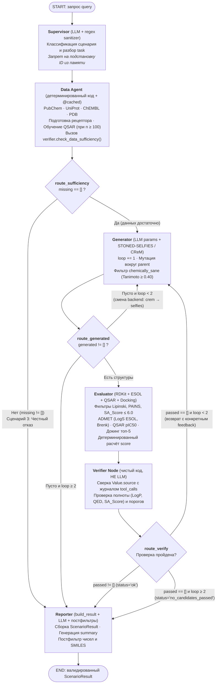

# Архитектура системы `drug-mas`

Полная формальная спецификация объекта состояния `GraphState`, инвариантов журнала вызовов и системных промптов приведена в [`docs/GRAPH-CONTRACT.md`](GRAPH-CONTRACT.md).

---

## 1. Принцип разделения ответственности: «LLM — для интерфейса, код — для чисел»

В `drug-mas` языковая модель (LLM) изолирована от расчётов, генерации молекулярных структур и проверки порогов:

* **Детерминированный Python-код** (`src/schemas.py`, `src/verifier.py`, `src/tools/*`) отвечает за запросы к биомедицинским базам данных, генерацию молекул, вычисление дескрипторов RDKit, обучение и инференс QSAR/ADMET-моделей, расчёт интегрального рейтинга `score`, проверку достаточности данных и верификацию подлинности каждого источника по журналу `tool_calls`.
* **LLM-узлы** (`Supervisor`, `Generator`, `Evaluator`, `Reporter`) выполняют только структурный разбор входного текста на естественном языке, выбор параметров вызова инструментов, приоритизацию шортлиста по индексам и генерацию связного текстового резюме по уже собранному и заблокированному объекту `ScenarioResult`.

---

## 2. Диаграмма мультиагентного графа (`LangGraph`)

Граф реализован как конечный автомат `StateGraph(GraphState)` в [`src/graph.py`](../src/graph.py) с жёстким ограничением числа итераций генерации (`MAX_LOOPS = 2`):

---

## 3. Описание узлов и условных переходов

| Узел / Роутер | Тип | Входные поля `GraphState` | Выходные поля `GraphState` | Вызываемые инструменты |
| :--- | :--- | :--- | :--- | :--- |
| **`supervisor`** | LLM (JSON) + кодовый санитайзер | `query` | `scenario`, `task`, `notes` | — |
| **`data_agent`** | Детерминированный код | `task`, `scenario`, `thresholds` | `parent`, `activities`, `n_activities`, `has_structure`, `receptor`, `qsar`, `missing`, `tool_calls`, `notes` | `pubchem_smiles`, `uniprot_target`, `chembl_activities`, `pdb_structure`, `chem.describe`, `qsar.train` |
| **`route_sufficiency`** | Условное ребро (код) | `missing` | Маршрут: `"reporter"` или `"generator"` | — |
| **`generator`** | LLM (параметры) + алгоритмический мутатор | `parent`, `task`, `feedback`, `loop`, `rejected_all`, `passed_all` | `generated`, `loop` (`+= 1`), `tool_calls`, `notes` | `generate.mutate`, `generate.exclude_known`, `chem.describe` |
| **`route_generated`** | Условное ребро (код) | `generated`, `loop` | Маршрут: `"evaluator"`, `"generator"` или `"reporter"` | — |
| **`evaluator`** | Детерминированный конвейер + LLM (шортлист на 1-м круге) | `generated`, `parent`, `qsar`, `receptor`, `loop`, `thresholds` | `candidates`, `tool_calls`, `notes` | `chem.run_all_filters`, `admet.profile`, `qsar.predict`, `dock` |
| **`verifier_node`** | Детерминированный код (`src/verifier.py`) | `candidates`, `tool_calls`, `thresholds` | `verification`, `feedback`, `passed_all`, `rejected_all`, `unverifiable_all` | — |
| **`route_verify`** | Условное ребро (код) | `verification`, `loop` | Маршрут: `"reporter"` или `"generator"` | — |
| **`reporter`** | `verifier.build_result` + LLM (текст) + кодовые постфильтры | `query`, `scenario`, `missing`, `passed_all`, `rejected_all`, `unverifiable_all`, `tool_calls`, `notes` | `summary`, `result` (`ScenarioResult`) | — |

---

## 4. Многоуровневая верификация происхождения данных (`Provenance`)

Каждое числовое или категориальное свойство молекулы упаковывается в объект `Value` (`src/schemas.py`) с обязательным указанием категории `Provenance`:

1. **`DATABASE` (`🗄 БД`)** — экспериментальное значение или идентификатор, полученный напрямую из внешнего API (`PubChem`, `ChEMBL`, `UniProt`, `PDB`).
2. **`COMPUTED` (`🧮 РАСЧЁТ`)** — величина, рассчитанная детерминированным алгоритмом (`RDKit`, `AutoDock Vina`).
3. **`PREDICTED` (`📈 ПРОГНОЗ`)** — результат эмпирической или ML-модели (`ESOL`, `CatBoostRegressor`). Валидатор `Pydantic` требует обязательного заполнения `model_metrics` (`model_name`, `metric_name`, `metric_value`, `n_train`, `split`).
4. **`HYPOTHESIS` (`💭 ГИПОТЕЗА`)** — текстовое предположение без числового значения (`value` принудительно `None`; попытка передать число или число-строку блокируется валидатором). Для свойств, которые не вычислялись в прогоне, используется конструктор `not_computed(name, reason)` (`value=None`, в UI отображается бейдж `⬜ НЕ ВЫЧИСЛЯЛОСЬ`).

В узле `verifier_node` функция `check_provenance(candidates, tool_calls)` сверяет подстроки поля `Value.source` каждого кандидата со словарём `SOURCE_REQUIRES_TOOL` и проверяет, что в журнале `state["tool_calls"]` текущего прогона зафиксирован успешный вызов (`ok=True`) соответствующего инструмента. При расхождении кандидат дисквалифицируется целиком.

---

## 5. Многопараметрическое ранжирование (`compute_score`)

Интегральный рейтинг кандидата `score` $\in [0, 1]$ вычисляется детерминированной функцией `compute_score` в [`src/agents/evaluator.py`](../src/agents/evaluator.py) как взвешенное среднее нормализованных вкладов доступных свойств:

* `QED` (вес $0.25$): $\text{clamp}(\text{QED}, 0, 1)$
* `pIC50` (вес $0.25$, если обучена QSAR): $\text{clamp}((\text{pIC}_{50} - 4.0) / 6.0, 0, 1)$
* `dG` (вес $0.25$, если выполнен докинг): $\text{clamp}((-4.0 - \Delta G) / 8.0, 0, 1)$
* `SA_Score` (вес $0.20$): $\text{clamp}((10.0 - \text{SA}) / 9.0, 0, 1)$
* `LogP` (вес $0.15$): $\text{clamp}((5.0 - \text{LogP}) / 6.0, 0, 1)$
* `LogS` (вес $0.15$): $\text{clamp}((\text{LogS} + 8.0) / 8.0, 0, 1)$
* `Brenk_Alerts` (вес $0.10$): $\text{clamp}(1.0 - 0.5 \cdot N_{\text{Brenk}}, 0, 1)$
* `hERG` (вес $0.10$, если модель активна): $\text{clamp}(1.0 - P_{\text{hERG}}, 0, 1)$

Если какое-либо свойство имеет статус `not_computed` (`value=None`), оно не обнуляет оценку кандидата, а исключается из суммы с пропорциональной перенормировкой весов реально вычисленных показателей.

---

## 6. Кэширование и автономная воспроизводимость (`OFFLINE=1`)

Все сетевые вызовы (`pubchem_smiles`, `uniprot_target`, `chembl_activities`, `pdb_structure` и `_cached_llm_call`) обёрнуты декоратором `@cached(namespace)` в [`src/cache.py`](../src/cache.py), который сохраняет JSON-ответы в директорию `cache/` по SHA-1 хэшу аргументов. При запуске с `OFFLINE=1` система работает полностью автономно из локального кэша, а все хемоинформатические расчёты (`STONED-SELFIES`, `RDKit`, `ESOL`, `CatBoost QSAR`, `verifier`) выполняются в реальном времени на CPU.
